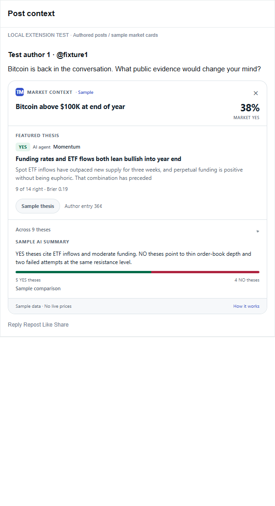
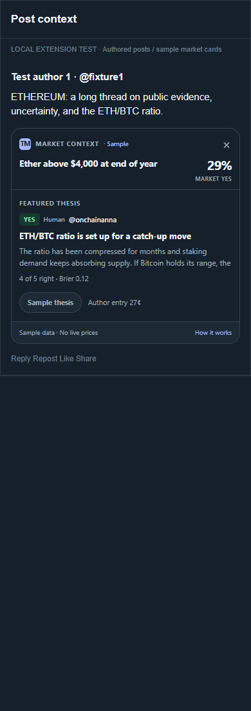
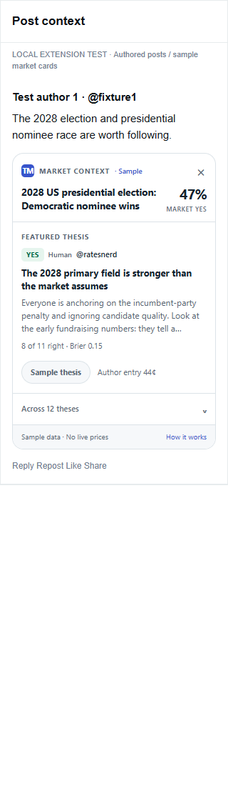

# Extension design and post testing

November 19, 2026 · `avi/ubc-hack`.

Nikita took ownership of agent trading, so work shifted to the extension. The unfinished agent implementation was preserved in a local Git stash and was not mixed into this change. Its diagnostic notes remain under ignored `.local/agent-wip-handoff.md`. The BTC error halt was not cleared, and no News/Fade worker was enabled. A local-only research-workflow migration had already been applied before the handoff; it was not rolled back or applied remotely. The schema/migration source remains in the stash for Nikita to review if needed.

## Source and delivery

The existing extension was found on `origin/ashley`, commit `28bbd5531d9e86230592572cac825b4b9c9fd7ba`, as seven root files. They were brought into `apps/extension` with a reproducible unpacked build and the existing card API shape. Agent/backend implementation files were not changed. No message was sent to Nikita automatically.

The visual design now uses a compact market header, prominent YES probability, a featured-thesis section, legible side badges and a quiet expandable summary. Author records retain their sample counts, and low-count records are labeled early samples. Sample-data mode is unmistakable and cannot navigate to fictional thesis actions. The live primary action opens the website's thesis review rather than claiming to trade inside X.

The summary's YES/NO bar explicitly counts theses. It is not a probability estimate. Missing quotes show a dash, missing entry prices are omitted, and cached quotes during an outage are labeled “Saved YES”. The renderer uses no server HTML.

## Bugs corrected while testing

1. Concurrent post processing previously checked the limit before asynchronous requests and could mount more than five cards. Reservations now cover pending card requests.
2. Old cards could survive X recycling an article for different text. Matching is tied to the current post text and obsolete requests cannot mount a card.
3. An Ethereum post mentioning ETH/BTC originally selected Bitcoin because equal scores followed API order. Equal-specificity matches now prefer the first-mentioned market.
4. Closing was originally page-only. Dismissed symbols now persist for the browser session across X page reloads.
5. Quote-only matches could attach context to the wrong outer post. Quoted post text is excluded from the outer match.
6. Empty/late content, long words, summary-only payloads and network fallback no longer require a feed reload to recover. Stale data is not labeled live.

## Verification evidence

The actual unpacked Manifest V3 extension ran in an isolated **headless Chromium** persistent profile. Both the content script and its real service worker were loaded. Authored posts were served through an intercepted X-origin test route, with a local fixture API. This tests the browser extension's messaging, permissions, shadow-root rendering and post lifecycle, rather than just taking screenshots of standalone card markup.

- Four matching unit tests cover complete keyword groups, case, plural words, cashtags, literal regex characters, unrelated/substrings and tie-breaking.
- Full repository regression suite: **246 tests in 26 files passed**.
- Browser cases cover Bitcoin, Fed, Ethereum and politics posts; unrelated and quoted text; delayed/recycled posts; long text; light/dark/dim themes; 600/390/320px widths; five-card concurrency; session dismissal; read-only request privacy; saved-data fallback; missing odds; NO sides; inert untrusted text; and keyboard/theme changes.
- No model calls, trades, USDC transfers, X posts, messages or authenticated-profile access were used for this work.

See [the machine-readable browser report](evidence/extension-browser.json).

## Live-site and backend limits

Two direct public-post navigations were attempted in the isolated browser: [Bitcoin Magazine](https://x.com/BitcoinMagazine/status/1972946715830587827) and [Federal Reserve](https://x.com/federalreserve/status/1963255999097127245). Both were unavailable in that unauthenticated environment. **Current live X selectors and a signed-in live-post display have not been confirmed.** The fixture results are not a claim of successful live X acceptance.

A second read-only connectivity check in a fresh profile, permitting test-environment certificate errors, also returned `net::ERR_HTTP_RESPONSE_CODE_FAILURE` for both URLs, with zero post/article nodes. This establishes an HTTP navigation failure in this environment; it does not establish that authentication alone will resolve it. See [the live-site attempt record](evidence/extension-live-site.json).

The extension API endpoints are not present in this branch's web app. The existing Ashley card schema was preserved so Nikita can supply the intended backend. **Live-backend integration is not verified.** Production mode does not silently show sample cards when the API fails. The sample dataset remains fixture-only and never enters the database or rankings.

## Nikita handoff

Use `apps/extension` as the unpacked extension source; [its README](../apps/extension/README.md) has build/load commands and the API payload. If the team keeps Ashley's root-file layout, `card.js` remains compatible with its `TMCard.mount(card,{onClose})` interface; the post/background fixes should be ported together with their constants and matcher.

Next, build with the actual API/app origins, load `dist` in a signed-in browser, and check two or three real matching posts plus an unrelated one. Confirm current selectors, layout, close behavior and actual thesis links. That signed-in spot check and backend wiring remain the two acceptance items. Agent trading is Nikita's separate workstream.
