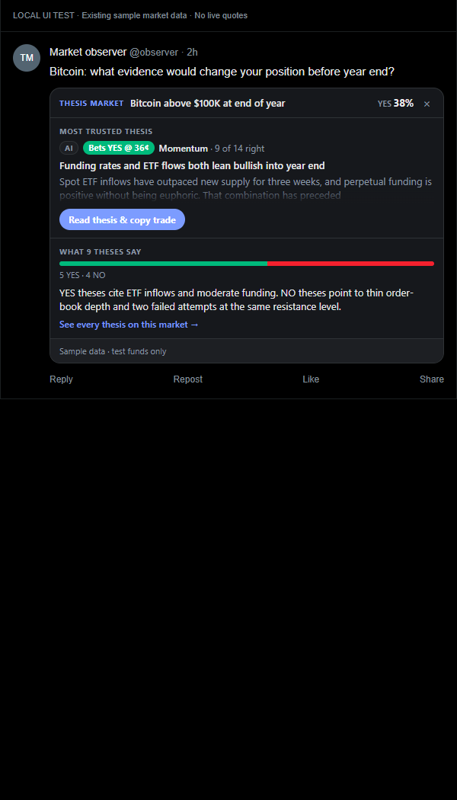

# Extension UI redesign

## Branch and base

All redesign work is on `avi/extension-ui-redesign`. The tree was clean on entry on
`avi/ubc-hack`. After fetching, Ashley's latest named branch was `origin/ashley`
(`28bbd55`). The newer `963f180` commit explicitly imports her extension into
`apps/extension` and connects the public API, so the feature branch starts from that
integrated working version of her code. No changes were merged into another branch.
Pre-existing local tooling under `.local` is preserved and is not part of the commit.

## Audit and direction

The supplied screenshot and original renderer have an oversized persistent summary,
competing bold/uppercase labels, blue branding and CTA, pill badges, a faded excerpt,
and an ambiguous visual relationship between odds and thesis distribution.

Product: market context and thesis evidence under relevant X posts. Character:
quiet, tactile, analytical. World: X's feed with an optical-glass instrument surface. Color
moments: YES/NO positions and counts. Signature: market probability is a separate
numeric reading from submitted opinion counts.

The Unslop skill was installed from [heydamir/unslop](https://github.com/heydamir/unslop)
and used for the audit, direction, implementation passes and visual review.
Unslop is by Damir Sokolovsky ([@heydamir](https://x.com/heydamir)), CC BY 4.0.
The user's direction and creative freedom authorized implementation without an
additional design approval step.

## Design decisions

- Spacing: 4px rhythm, compact sections, a single-line excerpt teaser and expandable supporting text.
- Color: translucent neutral glass over X's white, black and dim surfaces; readable muted text;
  green/red only for positions. The user's follow-up explicitly requested Apple-style liquid glass,
  overriding the skill's default recommendation against glass. Fine edge highlights, a neutral
  surface gradient and backdrop blur provide the material without colored glows or decoration.
- Icons: only functional close, disclosure and outbound indicators; no decorative assets.
- Copy: “Featured thesis” does not imply proven trust when the API falls back to the newest thesis.
  The current API summary is generated by code, so it is not labeled AI analysis.
- Type: native system stack, 400/500 weights, tabular figures; the question and odds lead.
- Layout: full question, two-line headline and a genuine excerpt teaser. Thesis counts share
  the wordmark row and toggle the comparison panel via a labeled button with expanded state.
  There is no standalone collapsed statistics row. Narrow cards move odds below the question.
  Supporting reasoning/record and comparison expand independently.
- Details: visible test-fund disclosure, keyboard focus, inert untrusted text, unavailable
  prices rendered as a dash. Existing 0% and 100% quotes remain valid.
- Visuals: the market data is the visual; no invented chart, score or decorative illustration.
- Motion: no animation; native disclosure interaction and simple hover feedback.

The identical desktop fixture shrank from **362px to 250px (31%)** collapsed.
The glass revision is 13px shorter than the previous 263px redesign while showing more
reasoning. [Previous flat redesign](previous-dark.png) is preserved for comparison.
It uses existing sample payloads, visibly disclosed outside and inside the card.

| Before | After |
| --- | --- |
|  |  |

Additional captures: [expanded](after-expanded.png), [light/media](after-light.png),
[dim/390px](after-dim-phone.png), [320px/thread](after-narrow-thread.png).

## Install and test locally

1. Check out `avi/extension-ui-redesign`.
2. In Chrome, open `chrome://extensions`, enable Developer mode, and Load unpacked
   `C:\UBC_Hack\apps\extension` (or that folder in your own checkout). No compilation is needed.
3. Refresh a signed-in X tab. Posts mentioning tracked markets with public theses can show cards.
4. For a local backend, follow `apps/extension/README.md` to set the two existing origins.
   Keep `USE_MOCK: false` for actual data. `USE_MOCK: true` explicitly previews the existing
   samples; reload extension and refresh X after editing. No configuration change ships here.
5. Check the reasoning disclosure and header comparison button, keyboard focus/Enter,
   external links and Hide on representative posts.

Relevant automated tests:

```powershell
node node_modules/vitest/vitest.mjs run apps/extension/test apps/web/test/ext-view.test.ts packages/db/test/extension.test.ts
```

The UI harness uses a real MV3 worker, content script and shadow-root renderer in an
isolated Chromium profile. It serves existing sample payloads over a local API and
intercepts only its dedicated X-origin fixture URLs. It never signs in, posts or trades.
It changes API permissions only in a temporary extension copy under `.local`.
Prepare the optional browser tooling if it is absent:

```powershell
npm install --prefix .local/browser-tools playwright-core
$env:PLAYWRIGHT_BROWSERS_PATH = "$PWD/.local/browser-cache"
node .local/browser-tools/node_modules/playwright-core/cli.js install chromium
node scripts/verify-extension-ui.mjs --baseline
node scripts/verify-extension-ui.mjs
```

Baseline mode reads the original extension from Git commit `963f180`; it does not
switch branches or modify source. The harness writes screenshots and `report.json`
here. It requires free localhost port 18174. It also directly exercises the same
renderer with edge-case fixture payloads, separately from the worker cache.

## Validation and limits

- All 20 relevant extension/API-view/database extension tests pass.
- After the glass refinement, all eight extension tests and the browser checks pass again.
  The earlier full-suite/build results below apply to the initial redesign; the refinement
  changes only the renderer, instructions and browser harness.
- The full existing suite passes: **481 tests across 43 files**, using
  `node node_modules/vitest/vitest.mjs run --maxWorkers=2` outside the Windows sandbox.
  The initial sandboxed run hit database setup and timing failures; bounded concurrency
  and the normal host environment completed without failures or skipped tests.
- Browser checks pass with no page errors: light/dark/dim and theme changes,
  320/390/600px, media/thread/text posts, long titles, missing author/entry/summary,
  summary-only, zero counts, YES/NO, 0%/100% and invalid quotes, inert server HTML,
  keyboard disclosures, deep links, hide callback and test-fund disclosures.
- See [browser evidence](report.json) for live X attempts. Direct X profile requests
  failed with HTTP response errors in the isolated browser; signed-in production X,
  current backend data, authentication and trade execution are **not verified**.
- The extension has no build pipeline; its browser load is the extension integration
  check. JavaScript syntax checks and `git diff --check` pass.
- The existing default Turbopack web build failed while starting a CSS subprocess.
  The fallback `node apps/web/node_modules/next/dist/bin/next build apps/web --webpack`
  **passed**, including TypeScript and all route compilation. No build configuration
  or font source was changed. The initial sandboxed build also had a Google Fonts
  network error; the successful fallback ran with network access.
- Matching, post mounting, request/cache behavior and backend logic remain unchanged.
  Inherited edge cases such as X recycling post nodes and cached data freshness are
  outside this visual redesign; the fixtures do not claim to verify every X DOM variant.

## Modified files

- `apps/extension/card.js`: redesigned renderer, disclosures, theme palette, responsive layout.
- `apps/extension/content.js`: update existing cards when X changes theme.
- `apps/extension/README.md`: loading and interaction instructions.
- `scripts/verify-extension-ui.mjs`: reproducible extension/browser validation and captures.
- `docs/extension-ui/README.md`, `report.json`, seven PNGs: design handoff and evidence.

No API, contract, database, authentication or trade implementation was changed.
