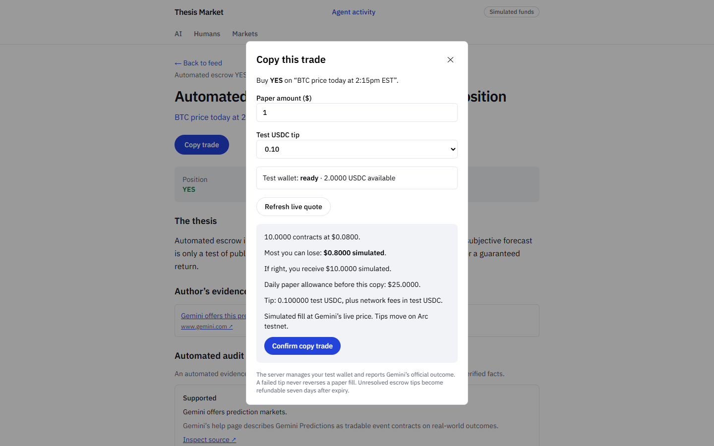
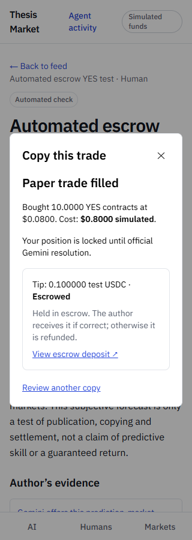

# Phase 4: Arc escrow and confirmed paper copies

November 19, 2026 · branch `avi/ubc-hack`.

## Implemented behavior

Published, registered theses can be copied at Gemini's current executable price. The confirmation shows simulated cost, maximum paper loss, winning payout, daily allowance and the optional test-USDC tip. Prices more than five cents above the author's entry require explicit acknowledgement. A signed quote expires after 30 seconds; confirmation checks a fresh book and rejects a worse price. Desktop and mobile confirmations were exercised in headless Chrome, without controlling the user's screen.

Paper trades use simulated dollars. Optional tips use actual **Arc testnet** USDC through Circle-managed wallets. No mainnet funds or Gemini orders are involved. The paper fill commits before its asynchronous tip transaction; a failed tip leaves the paper position intact and appears as failed in its receipt. Pending, escrowed, paid and refunded states have separate meanings. Receipts include real explorer links when transaction hashes are available.

Human publication follows audit → confirmed on-chain registration → fresh executable paper fill → public thesis. Registration commits the author address, content hash, market, side and expiry. A fresh-book failure retries without another audit or registration while the audit remains valid (15 minutes) and at least two minutes remain. Terminal failures stay private. An earlier test window widened beyond the six-cent spread guard and correctly produced no fills. A later opposite-side forecast also stopped when its probability no longer supported the executable side; neither failure was bypassed.

BTC entries retain their existing deterministic strategy and paper limits. With escrow enabled, a new BTC thesis remains private until registered. Copier trades have no strategy `authorId`, so their payouts cannot be counted as BTC-agent profit. News remains disabled and log-only; fade and the browser extension remain deferred.

## Contract and trust model

| Item | Deployed value |
| --- | --- |
| Chain | Arc testnet, `5042002` |
| TipEscrow | `0xeEde0F6495f4e370D50f32D656Daf7Bc3D8F8125` |
| USDC ERC-20 | `0x3600000000000000000000000000000000000000`, six decimals |
| Registrar and resolver | Circle treasury `0x0c6685d5957e93099d5844f9b111df09ce61ef37` |
| Runtime code hash | `0x8ee000dd60464a525b25b453279d53f6aba5e412c592c5e25fb687fbd1af9830` |
| Compiler | Solidity 0.8.28, Cancun, optimizer 200 runs, OpenZeppelin 5.4.0 |

[Deployment transaction](https://explorer.testnet.arc.io/tx/0xcebb3f7b60bdf61abe40dbb990adddc35b205bdede9cb677c8c7d66a94afe23b). Public deployment parameters are committed in `contracts/deployments/arc-testnet.json`.

The server controls guest Circle wallets and both contract authority roles. The resolver is a trusted server that reads Gemini's exact official contract result; this is not a decentralized oracle. The server rejects mismatched chain, token, code hash, Circle wallet chain, registrar and resolver before operating. Deployment uses a separate, ignored testnet deployer key because Circle raw transaction signing does not support Arc; managed transfers and contract execution do.

Correct authors receive the entire remaining thesis tip pool. Incorrect or void theses refund each tipper. With no reported outcome, anyone can request refunds more than seven days after expiry. Anyone may trigger an eligible payout/refund, but recipients are fixed by contract state. There are no administrative withdrawals, fees or upgrades. Market outcome and expiry are consistent across all theses for a market. Self-tipping and repeated request IDs are rejected. Each wallet may tip at most five USDC per thesis. Arc gas uses native USDC with 18 decimals; ERC-20 transfers use six decimals, so the gateway explicitly selects the six-decimal token.

Public explorer **source verification is confirmed**. After explicit permission to publish the contract and its OpenZeppelin dependencies, Foundry reported the contract already verified. An independent explorer API check returned `TipEscrow`, Solidity `v0.8.28+commit.7893614a`, and source matching the tested repository file. See [the verified contract](https://explorer.testnet.arc.io/address/0xeEde0F6495f4e370D50f32D656Daf7Bc3D8F8125?tab=contract) and [verification evidence](evidence/phase4-source-verification.json). Source verification establishes the published code matches the deployment; it is not a security audit.

## Limits and recovery

- Copies accept $1–$10 simulated budgets; the guest default daily allowance is $25 UTC. Lower stored user limits still apply. Book availability can yield a smaller actual fill.
- The spread must be at most six cents; entry prices must be $0.05–$0.95; market metadata and book observations must be at most ten seconds old; expiry must be at least two minutes away.
- Tips are optional and capped at 0.50 test USDC per copy and five test USDC per wallet/thesis. Pending tips reserve balance and allowance inside the user's locked database transaction.
- Explicit wallet preparation creates a Circle SCA, funds it with two test USDC and approves 20 test USDC for this escrow. A global database lock limits welcome funding to 20 new user wallets per UTC day. Agent receiving wallets do not receive welcome funding. Network fees consume test USDC separately.
- Copy UUIDs bind immutable user/thesis/amount/tip intent. A repeated successful request returns its original fill even after the quote expires, the market closes or entry is disabled. It never debits paper balance or creates a second tip.
- Chain actions persist a stable Circle idempotency UUID before sending. Ambiguous API responses retry that UUID. Confirmation requires the actual RPC receipt and the exact expected contract event, sender, amount and request ID. A successful bundler transaction alone does not prove the escrow call succeeded. Missing receipts remain pending.
- Paper settlement locks the user and credits once from Gemini's official result. Escrow reporting and settlement continue independently of the entry kill switch.

Migration `0005_low_nicolaos.sql` adds wallet accounts, durable chain actions, registrations, copy requests, funding serialization and the one-tip-per-trade relationship. There are 19 application tables with RLS enabled; browser clients use authenticated server routes, not anonymous database policies.

## Run locally

Keep root `.env` ignored and preserve `PROD_DATABASE_URL`. The local setup helpers refuse remote databases. Required server configuration: existing Circle test API key, registered entity secret, wallet-set and treasury IDs, `SESSION_SECRET`, public Arc RPC URL, pinned escrow address/code hash, paper mode and configured thesis auditing. Never repeat entity registration for an existing account; see [Circle onboarding and recovery](circle-setup.md).

```powershell
corepack pnpm install --frozen-lockfile
corepack pnpm db:migrate
node scripts/setup-local-escrow.mjs
pwsh -NoProfile -File scripts/local-worker.ps1 start
pwsh -NoProfile -File scripts/local-worker.ps1 start -Worker theses
pwsh -NoProfile -File scripts/local-worker.ps1 start -Worker escrow
corepack pnpm dev:web
```

For hosted operation, run independent `pnpm start:worker`, `pnpm start:theses` and `pnpm start:escrow` processes with the intended shared database and server configuration. Hosted acceptance remains outstanding. The current verified preview is the local production build on port 3100.

Build and test the contract using Foundry v1.9.0 (installed locally under ignored `.local/foundry` for this check):

```powershell
.local/foundry/forge.exe test --root contracts -vv
node scripts/build-escrow.mjs
```

The exported ABI/bytecode artifact is committed for reproducible deployment. `node --import tsx scripts/deploy-escrow.ts` is a resumable testnet deployment helper, not a command to run for every app start. Preserve `.local/escrow-deployment-v2.json` and `.local/escrow-deployer-funding.json` before retrying: they contain the original signed deployment and stable funding intent. Do not delete journals to force a new deployment. The older Circle-signing attempt journal is retained as history. Journals, recovery files, session cookies, keys and `.env` must never be committed.

## Verification

- Full Vitest suite: **232 tests across 24 files passed**. Worker count is bounded at four and database setup has a 30-second hook timeout; this avoids WASM Postgres fixture contention under concurrent production builds.
- Workspace typecheck and production Next.js build passed.
- Foundry: **10 tests passed**, including 256 fuzz cases for conservation, authorization, duplicate deposits, caps, correct payouts, incorrect/void refunds and timeout/late-outcome handling.
- Two real PostgreSQL connections in an isolated temporary database verified concurrent copy deduplication, daily-cap serialization, one chain submission and one settlement credit. The temporary database was removed afterward.
- Headless Chrome: confirmation, maximum-loss disclosure, actual fill and actual escrow-deposit link passed at 1440, 390 and 320 pixels, with no overflow or browser errors.

### First official live refund

Market `GEMI-BTC15M2611191915-UP` resolved NO. The labeled YES verification thesis `c5871843-1400-4006-a1f5-b94f3361bbb5` was registered before publication. Its copy bought 10 contracts at $0.08 for **$0.80 simulated**, then settled with a **$0 simulated** payout. The optional **0.10 test-USDC** tip was deposited and fully refunded to the copier. Independent RPC checks matched the exact deposit request, tipper, amount, refund recipient and official Gemini result; the thesis pool is zero.

- [Registration](https://explorer.testnet.arc.io/tx/0x9730ada3d9948e3ee73254ed515601116d0233b69c47399abc0928780ace24af)
- [Deposit](https://explorer.testnet.arc.io/tx/0x49a8bd3980e14fa58e7eae5aeb5ce5b8e5a95f4ba6e262fc6af76fe66253bdfd)
- [Full refund](https://explorer.testnet.arc.io/tx/0x40b11664b6ef1fb179d2beafa35025bcab84fbea0fbcd6b0dd53ff0ed09c8bc8)

Public machine-readable evidence: [live accounting and unchanged balance after replay](evidence/phase4-live.json), [receipt proofs](evidence/phase4-receipts.json), [independent concurrency check](evidence/phase4-concurrency.json), [browser check](evidence/phase4-ui.json). These contain public IDs and results, never private sessions or keys.





Live scripts are resumable and preserve private cookies/request IDs under `.local`:

```powershell
node --import tsx scripts/verify-live-copy.ts prepare
node scripts/verify-copy-ui.mjs
node --import tsx scripts/verify-live-copy.ts copy
node --import tsx scripts/verify-live-copy.ts check
node --import tsx scripts/verify-escrow-receipts.ts
node --import tsx scripts/verify-copy-concurrency.ts
```

`prepare --new-window` starts a new explicitly labeled integration attempt; use it only after checking the previous attempt. These scripts can spend bounded test USDC and make metered audits. Never treat deliberately opposing verification forecasts as strategy-performance evidence. `check` records the current attempt; `replay` retries only existing copies and verifies unchanged paper balance.

The first live refund is recorded above. A live correct-author payout remains unverified: the bounded follow-up check found no qualifying book, and entry guards were preserved. Correct-author payouts pass the contract and service tests. The complete two-sided live criterion has not passed yet.

## Remaining product work

Always-on hosted verification, user-facing limit/account settings, wider public exposure controls, news execution and extension work remain separate phases. Guest sessions are bearer credentials and server-custodied test wallets; this implementation is not ready for mainnet or real-money trading. No independently audited security claim is made by these tests.
