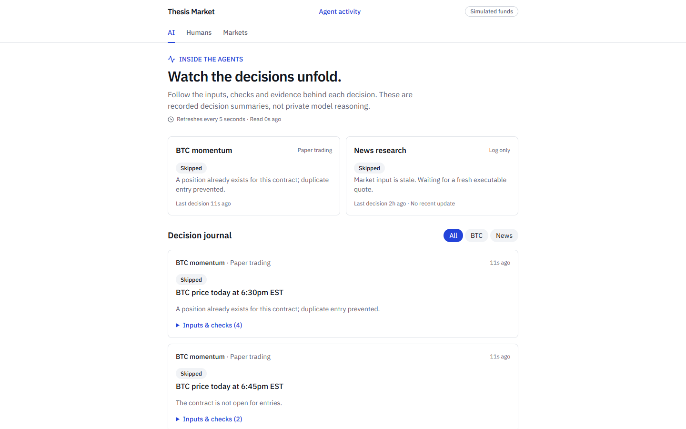
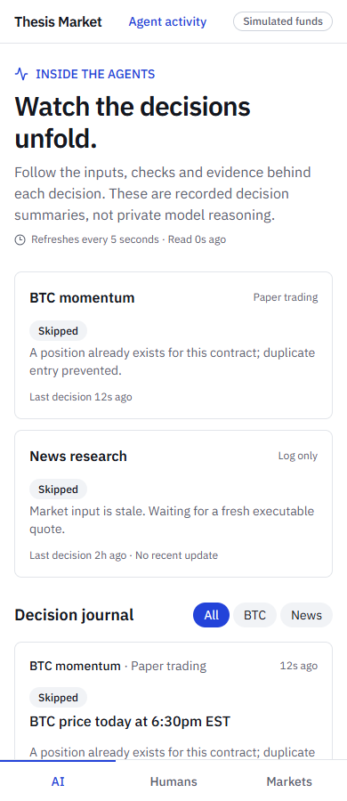

# Agent UI and live paper-trading verification

Completed November 18, 2026 (Pacific), on `avi/ubc-hack`, following commit `72360d2`.

## Outcome

The `/agents` production page passed desktop and mobile browser checks. Long market titles, summaries and citation text now wrap within narrow cards instead of causing horizontal scrolling. The local BTC worker also met its live-data paper acceptance criteria: four qualifying contracts with logged fills and three correct official settlements at the recorded checkpoint. All 192 repository tests passed, including the daily-loss-stop regression.

This milestone verifies simulated execution using production Gemini input. The bankroll is simulated dollars; Circle and Arc testnet USDC are not connected to the worker. No hosted deployment or hosted database changes were made for this verification.

## Changes

- `apps/web/components/agent-activity.tsx`: inherit `overflow-wrap: anywhere` through the activity view. This permits long uninterrupted research text to wrap without clipping or hiding it.
- `scripts/verify-agent-ui.mjs`: repeatable headless Chrome acceptance checks against a local production preview. Screenshots and a JSON report are written beneath ignored `.local/agent-ui/`.
- README, agent overview and worker/activity runbooks: replace outdated current-status claims with the new verification checkpoint. Historical checkpoints remain dated.

The browser uses a separate temporary profile and runs without taking over the user's screen or mouse. It does not start agents, submit trades or request Grok research. Error, empty-state and long-text cases use intercepted browser responses only; no fixture data is inserted into Postgres.

## Browser verification

Final production run: `2026-11-18T23:32:01.190Z` (3:32 PM Pacific). Ten check groups passed with no uncaught browser/hydration errors.

| Check | Result |
| --- | --- |
| Local activity API and recorded paper-entry/settlement milestones | Passed |
| 1440 × 900 desktop | Passed; no horizontal overflow |
| 768 × 900 tablet | Passed; no horizontal overflow |
| 390 × 900 phone | Passed; no horizontal overflow |
| 320 × 900 narrow phone | Passed; no horizontal overflow |
| All/BTC/News filtering and expandable inputs | Passed |
| Automatic activity API polling | Passed |
| Long title, summary, citation and expanded inputs at 320px | Passed after wrapping fix |
| Failed refresh retains data; Retry recovers to an empty state | Passed |
| Uncaught browser errors and hydration exceptions | None |

The long-text fixture reproduced a document width of 2119px in a 320px viewport before the fix. Afterward it fit within 320px. Stale research labels and external-link target/rel attributes were also checked. Desktop/mobile screenshots and long-text/error/empty-state captures were visually inspected.

The original development preview on port 3000 displayed server-rendered content but did not respond to client filter clicks in headless Chrome; its console reported HMR WebSocket failures. This development-preview issue was not resolved or treated as a passing interactive check. Acceptance used a fresh production build on port 3100, where filters and polling worked. Only Chrome was exercised; Firefox, Safari and physical-device testing remain outside this checkpoint.

### Desktop



### Phone



## Live BTC checkpoint

Read-only `check:btc-paper` result at `2026-11-18T23:23:16.413Z` (3:23 PM Pacific), against the existing local database populated by the supervised live worker:

| Evidence | Recorded value |
| --- | --- |
| Qualifying paper fills | 4 |
| Unique contracts with matching decision logs | 4 |
| Correct official YES/NO settlements | 3 |
| Incorrect settlement payouts | 0 |
| Live paper criteria met | `true` |
| Realized daily PnL | -$5.6500 simulated |
| Open exposure | $2.3000 simulated |
| Agent halted | `false` |

Supervisor status independently reported `running`, a connected stream, 30 completed volatility returns, a 3.3-second heartbeat age and a 3.9-second cycle age. The worker was left running without a restart, so its in-memory warmup was preserved. Counts and balances are a dated checkpoint and may change as it continues.

After verification, the temporary production preview on port 3100 was stopped. A final status check still showed the same supervised worker PID running, connected and fully warmed up; the pre-existing port-3000 preview was left untouched.

The check validates persisted payout amounts against recorded official market outcomes. Earlier runbook evidence covers an independent Gemini outcome fetch and an idempotent settlement replay for the first live position. These checks establish execution/accounting behavior, not strategy profitability. No entry thresholds or limits were relaxed to manufacture fills.

## Build and code checks

- `node node_modules/vitest/vitest.mjs run`: 20 test files, 192 tests passed. Includes the exact -$50 daily-loss halt and next-UTC-day recovery test.
- TypeScript checks passed for core, database, worker and scripts using their existing `tsconfig.json` files.
- `node node_modules/next/dist/bin/next build` from `apps/web`: passed, including web TypeScript validation and `/agents` plus `/api/agents/activity` output.
- Production headless browser acceptance: ten groups passed.

The first build attempt used Node's `--env-file` flag, which Next forwarded into an unsupported subprocess option. The successful build used the existing root-environment loader in `next.config.ts` instead. Initial sandbox restrictions blocked local process/database access; checks then ran with permitted local-service access. The package-manager download was unavailable in the restricted shell, so the existing Node test/typecheck executables were used directly.

## Reproduce

Use the repository's configured local Postgres database with existing live worker records. The milestone assertions require recorded paper entries and settlements, and the filter checks require records from both agents. Keep `DATABASE_URL` pointing to local verification data; `PROD_DATABASE_URL` is separate. Never seed fixture trades to satisfy live acceptance.

From the repository root, install only the headless testing library into ignored local tooling. An installed Google Chrome is required; no browser binary download is needed:

```powershell
npm install --prefix .local/browser-tools --no-save --package-lock=false playwright-core@1.65.1
```

Build and start a separate production preview from `apps/web` in a terminal:

```powershell
node node_modules/next/dist/bin/next build
node node_modules/next/dist/bin/next start --hostname 127.0.0.1 --port 3100
```

The current `next.config.ts` loads the ignored repository-root `.env`. Do not pass `--env-file` to the Next build command.

In another terminal, from the repository root:

```powershell
node scripts/verify-agent-ui.mjs
node --import tsx apps/worker/src/check-btc-paper.ts
pwsh -NoProfile -File scripts/local-worker.ps1 status
```

Optional browser overrides: `AGENT_UI_BASE_URL` selects another localhost preview; `CHROME_PATH` selects a Chrome executable. The verification script rejects non-local hosts. Inspect `.local/agent-ui/report.json` and the screenshots after a run. A browser-check failure returns exit code 1 and saves `failure.png`. Stop the preview with Ctrl+C when finished; keep the independent paper worker running.

## Remaining work

1. Resolve the existing development preview's HMR/client-interactivity issue if development-mode visual work resumes; production acceptance above is complete.
2. Publish the verified web build and run the worker on an always-on host using the intended database, then repeat health and acceptance checks there. Local acceptance does not establish hosted acceptance.
3. Keep news research log-only until the independent audit and execution/limit integration are implemented.
4. Implement Circle/Arc USDC tipping and payout flows, followed by copy trading and the remaining planned agent integrations.
